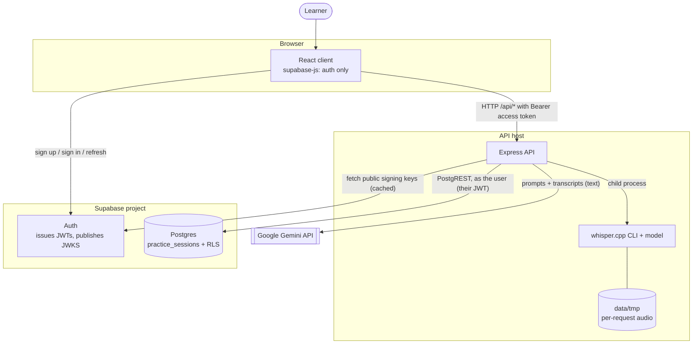
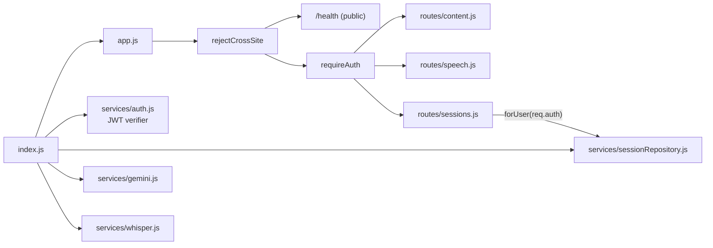
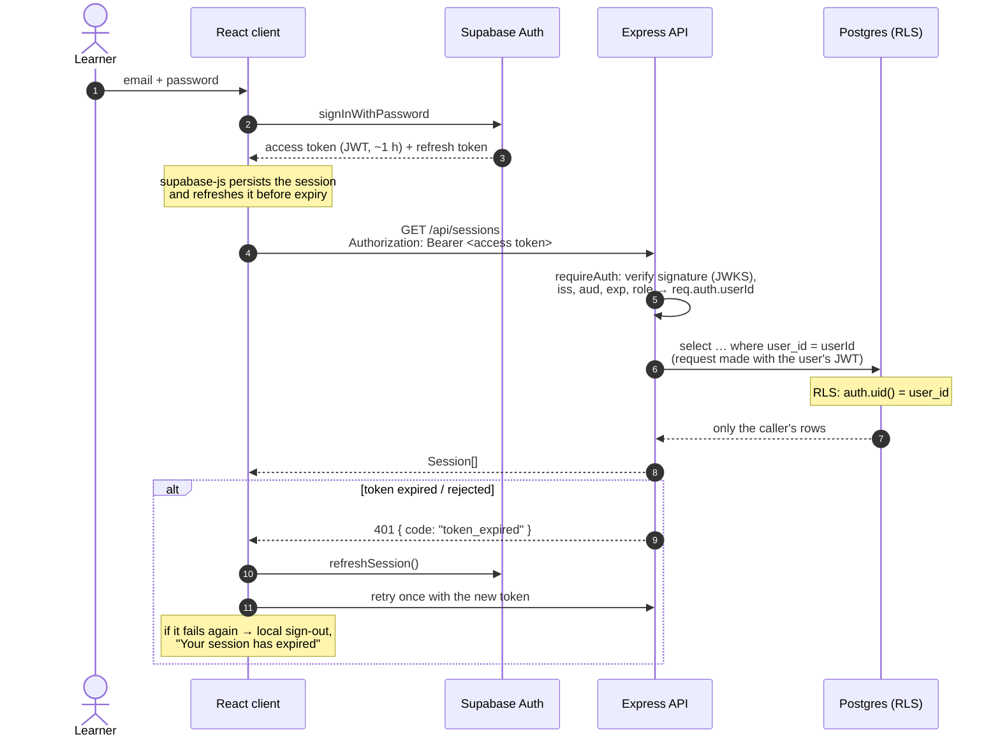

# Architecture

This document describes how Speak Up is put together: its components, how authentication and a practice attempt flow through the system, the HTTP API, the data model, and the security and failure model.

## System context

Speak Up is a multi-user web application. Learners sign in with Supabase Auth, and their practice history lives in Supabase Postgres, private to each account. Transcription runs on the API server with whisper.cpp; analysis is done by the Gemini API.

**Trust boundaries.**
- **The browser** is untrusted. Every request is authenticated and validated on the server, and identity is taken only from a verified token.
- **Gemini** is an untrusted *output* source. Its replies are constrained by a schema, scores are clamped, and the overall score is recomputed on the server.
- **The database** independently enforces ownership with Row Level Security, so a defect in the API cannot expose another user's rows.

## Components

### Client (`client/`)

A React single-page app with no router. `App.tsx` is an auth gate: signed-out visitors only see `AuthScreen`. Signed-in users get the practice app, which is **keyed by user id**, so switching accounts remounts everything and no state carries over.

| Module | Responsibility |
| --- | --- |
| `auth/AuthProvider.tsx` | Owns the Supabase session. Restores it on load (persisted by supabase-js and refreshed automatically) and tracks sign-in and sign-out. It gives the API client `getAccessToken`, `refreshAccessToken` and `onSessionExpired`. |
| `auth/useAuth.ts`, `auth/authErrors.ts` | Hook for components; friendly messages for Supabase Auth errors (no hint whether the email or the password was wrong). |
| `lib/supabase.ts` | Browser Supabase client, configured with the **public** publishable key and used for authentication only. |
| `lib/api.ts` | Typed `fetch` wrapper. Attaches `Authorization: Bearer <token>`. On `401 token_expired` or `token_invalid` it refreshes once and retries the same request; if that fails it calls `onSessionExpired`, which signs out locally and shows "session expired". |
| `components/auth/AuthScreen.tsx` | Sign-in / create-account form, plus the "check your email" state when confirmation is required. |
| `components/layout/*` | Header, navigation, `AccountMenu` (email and sign-out), and `SystemStatus` (backed by `GET /api/health`). |
| `components/practice/PracticeFlow.tsx` | One attempt: `prep → practice → transcribing → analyzing → report`, then saves the result to the user's history. |
| `components/history/*` | The user's sessions: stats, chart, focus areas, reports, retry and delete. All of it is computed from `GET /api/sessions`, which only ever returns the caller's sessions. |
| `components/modes/*`, `report/*`, `ui/*`, `lib/fluency.ts`, `lib/wavEncoder.ts`, `lib/scores.ts`, `lib/insights.ts` | Unchanged by the multi-user work: practice content, reports, design primitives and pure logic. |

### Server (`server/`)

Express 5 with ES modules. `src/index.js` is the composition root: it builds config and services, then passes them into `createApp()`.

| Module | Responsibility |
| --- | --- |
| `services/auth.js` | `createTokenVerifier`: verifies signature, issuer (`<SUPABASE_URL>/auth/v1`), audience (`authenticated`), expiry, `role = authenticated` and a UUID `sub`. `createSupabaseTokenVerifier`: uses the project's public JWKS (remote, cached by `jose`), or `SUPABASE_JWT_SECRET` for legacy HS256 projects. `requireAuth`: parses the Bearer header and sets a frozen `req.auth = { userId, email, token }`. |
| `services/sessionRepository.js` | `forUser({ userId, token })` returns `list`, `create` and `remove`. Each call builds a fresh supabase-js client carrying **that user's token** (no shared or cached client) and also filters by `user_id`. Database errors map to client-safe `HttpError`s. |
| `routes/sessions.js` | `GET /sessions`, `POST /sessions`, `DELETE /sessions/:id`. Ownership comes only from `req.auth`. |
| `routes/content.js`, `routes/speech.js` | Topics, vocab, sample answers, transcription and analysis. Stateless, but behind `requireAuth` because they spend Gemini quota and CPU. |
| `app.js` | Middleware order and the central error handler, which returns `{ error, code? }` and logs details only for 5xx. |
| `scripts/import-legacy-sessions.js` | Operator-run, explicit-owner import of the old JSON history (see [Data migration](#legacy-data-migration)). |

## Authentication flow

## Data flow: one practice attempt

1. **Content.** `POST /api/topics`, `/vocab` or `/interview-sample` (authenticated) → Gemini → JSON.
2. **Record.** The browser records with MediaRecorder and encodes 16 kHz mono 16-bit WAV.
3. **Transcribe.** `POST /api/transcribe` (multipart, authenticated). Auth runs *before* multer, so anonymous uploads never reach the disk. The upload is written to `data/tmp/<random-uuid>.wav`, whisper.cpp writes a JSON file next to it, and **both files are deleted before the response is sent**, including on failure. Concurrent uploads get distinct random filenames.
4. **Metrics.** Computed in the browser from the transcript and segment timestamps.
5. **Analyse.** `POST /api/analyze` → Gemini with a response schema. The server clamps the scores and computes the weighted overall score.
6. **Save.** `POST /api/sessions`. The server validates the payload and inserts it with `user_id` taken from the verified token, using the user's JWT. Postgres assigns `id` and `created_at`. If saving fails, the report stays on screen with a warning.

No audio is stored permanently, and nothing user-specific is held in server memory between requests.

## HTTP API

All endpoints are under `/api`. Errors are `{ "error": string, "code"?: string }`.

| Method & path | Auth | Request | Success | Notable errors |
| --- | --- | --- | --- | --- |
| `GET /health` | public | – | `{ gemini, whisper, auth: { configured } }` (setup flags only) | – |
| `POST /topics` | required | `{ category?, difficulty?, theme?, count?, interview? }` | `200 string[]` | `400` |
| `POST /vocab` | required | `{}` | `200 VocabEntry` | – |
| `POST /interview-sample` | required | `{ question, framework }` | `200 { sample }` | `400` |
| `POST /transcribe` | required | multipart `audio` (WAV, ≤ 25 MB) | `200 { text, segments, durationSec }` | `400`, `413`, `503`, `504` |
| `POST /analyze` | required | `{ topic, transcript, metrics }` | `200 AnalysisResult` | `400` |
| `GET /sessions` | required | – | `200 Session[]`, the **caller's** sessions, newest first | `503 db_unavailable` |
| `POST /sessions` | required | `{ mode, topic, transcript, metrics, analysis }`; any `user_id`, `id` or `date` sent is ignored | `201 Session` | `400`, `503` |
| `DELETE /sessions/:id` | required | – | `204` | `400` (not a UUID), `404` (missing **or** not yours, deliberately indistinguishable) |

**Authentication errors** (all `401`, with `WWW-Authenticate: Bearer`):

| `code` | Meaning |
| --- | --- |
| `auth_required` | No Bearer token was sent. |
| `token_expired` | The token is valid but has expired; the client refreshes and retries once. |
| `token_invalid` | Bad signature, wrong project or audience, anon role, or malformed. |

`503 auth_unavailable` means the signing keys could not be fetched; `503 auth_not_configured` means Supabase is not set up. AI routes may also return `429`, `502` or `503`. Cross-site browser requests get `403`.

## Data model

Defined in [`supabase/migrations/20261010120000_create_practice_sessions.sql`](supabase/migrations/20261010120000_create_practice_sessions.sql):

| Column | Type | Constraints |
| --- | --- | --- |
| `id` | `uuid` | primary key, `gen_random_uuid()` |
| `user_id` | `uuid` | not null, default `auth.uid()`, FK → `auth.users(id)` **on delete cascade** |
| `created_at` | `timestamptz` | not null, default `now()` |
| `mode` | `text` | `in ('random','interview','vocab')` |
| `topic` | `text` | 1–1000 characters |
| `transcript` | `text` | 1–50 000 characters |
| `metrics` | `jsonb` | must be an object |
| `analysis` | `jsonb` | object with `scores` (object), numeric `scores.overall`, and array `grammarIssues` |

The index `(user_id, created_at desc)` serves the only query pattern: one user's history, newest first.

`metrics` and `analysis` are JSONB because they are produced and consumed as whole documents. They have evolved over time (sessions saved by earlier versions lack some fields), and they are never filtered on in SQL. The check constraints guarantee the fields the history views depend on. Deleting a user deletes their sessions.

The API returns rows as `Session { id, date (= created_at), mode, topic, transcript, metrics, analysis }`; `user_id` is never sent to the client.

### Legacy data migration

The single-user version stored ownerless sessions in `server/data/sessions.json`. They are **not** migrated automatically, and the server never reads that file. `npm run import:legacy --prefix server -- --user-id <uuid> [--apply]` imports them, and:

- requires the operator to name the owner explicitly, checks that the account exists, and prints its email for confirmation;
- dry-runs unless `--apply` is given;
- validates each record and skips invalid ones with a reason;
- keeps each record's id and date, and skips ids that already exist, so re-running is safe and never re-assigns a row.

The script uses the service-role key, because it writes rows for a user who is not the caller and sets `created_at`. That is why it is a local, operator-only tool.

## Security model

- **Authentication on every private endpoint.** `requireAuth` runs before every router except `/health`, including the AI and upload routes. The token is verified cryptographically on each request; nothing about identity is read from the body, query string or cookies.
- **Ownership is enforced twice.**
  1. The repository filters every query by `req.auth.userId`.
  2. Every query is made **with the user's own JWT** through a per-request client, so Postgres RLS policies (`(select auth.uid()) = user_id` for select, insert-check and delete) apply independently.

  The running API is configured only with the public publishable key; it holds no credential that bypasses RLS.
- **Least privilege in the database.**
  - All privileges are revoked from `anon` and `authenticated`.
  - Only `select`, `delete` and column-limited `insert` (`user_id, mode, topic, transcript, metrics, analysis`) are granted.
  - There is no `update` privilege or policy, so sessions are immutable, and clients cannot choose `id` or `created_at`.
  - Signed-out callers have no access.
- **Direct database access.** The publishable key is in the browser bundle, so a signed-in user could call PostgREST directly. RLS confines them to their own rows, and the check constraints still apply. They could insert unusual but well-formed sessions into *their own* history; this is an accepted limitation.
- **No information leaks across users.**
  - A delete of someone else's session returns the same 404 as a missing one.
  - Owner ids are never returned.
  - Error responses for database failures are generic, with details only in the server log.
- **Secrets.** `server/.env` and `client/.env.local` are gitignored; the examples contain placeholders only. The service-role key is used only by the import script and the opt-in integration tests, and must never have a `VITE_` prefix.
- **Token lifetime.** Verification is local (signature and claims), so a token remains usable until it expires (Supabase default: 1 hour) even after the user signs out elsewhere. This is the trade-off for verifying locally without a network call per request; shorten the JWT expiry in Supabase if that window is too long.
- **Unchanged from the single-user version:**
  - `Sec-Fetch-Site` cross-site rejection;
  - no CORS headers (same-origin through the Vite proxy or Express static serving);
  - loopback bind by default;
  - input validation and upload limits;
  - JSON-escaped prompt interpolation.

## Error handling

| Layer | Strategy |
| --- | --- |
| Auth | Missing → 401 `auth_required`; expired → 401 `token_expired`; any other verification failure → 401 `token_invalid`; JWKS unreachable → 503 `auth_unavailable`. |
| Database | Network failure → 503 `db_unavailable`; PostgREST JWT rejection → 401 `token_expired`; check violation → 400 `invalid_session`; anything else → 500. The underlying error is kept as `cause` and logged. supabase-js retries network failures with backoff, so an unreachable database takes a few seconds to report. |
| Routes | Express 5 forwards rejected promises to the central handler; expected failures throw `HttpError(status, message, code)`. |
| Client | `ApiError { status, code }`; token errors trigger one refresh-and-retry, then a local sign-out with a message. Every screen renders API errors. |

## Testing strategy

| Level | Where | What |
| --- | --- | --- |
| Unit | `server/test/auth.test.js` | The real verifier with locally generated ES256 keys and a local JWKS: valid, expired, wrong key, issuer and audience, anon role, non-UUID subject, unsigned/malformed, legacy HS256, and JWKS-fetch failure. |
| HTTP | `server/test/app.test.js` | The real app and real verifier, with an in-memory per-user repository: 401s on every private route, uploads not written when unauthenticated, owner taken from the token, A/B list and delete isolation, identical 404s, database-failure responses, plus the existing AI, transcription and validation tests. |
| Contract | `server/test/sessionRepository.test.js` | The real supabase-js client against a local HTTP stand-in for PostgREST: user token sent, `user_id` filters present, no `id`/`created_at` sent, per-user clients under concurrency, and the failure mapping (unreachable, 500, JWT rejected, constraint, unconfigured). |
| Real project (opt-in) | `server/test/supabase.integration.test.js` | Two throwaway users against a real Supabase project: API isolation, and direct-to-database RLS checks (cross-user select, insert and delete; update denied; `created_at` denied; anon denied), invalid token, concurrent writes. |
| Unit (client) | `client/src/**/*.test.ts` | API client token handling (Bearer header, single refresh-and-retry, session expiry, no retry on non-token errors), auth error messages, metrics, scores, insights, and the WAV encoder. |
