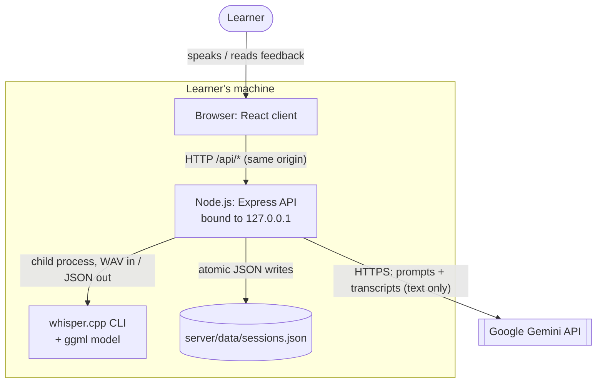
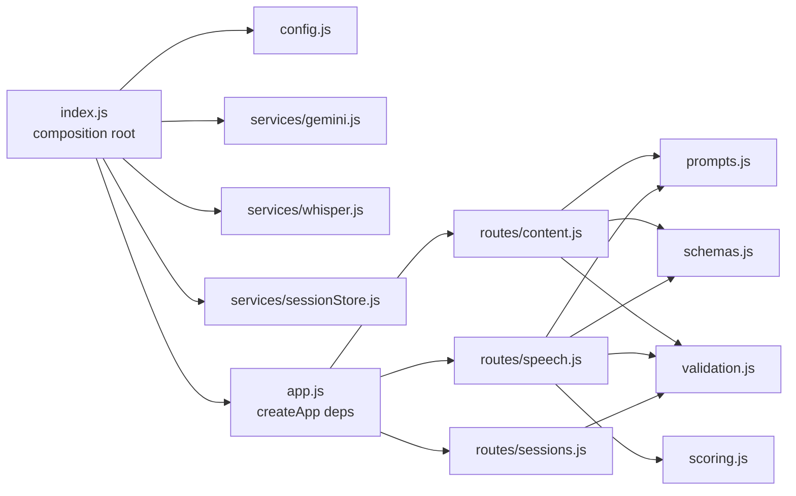
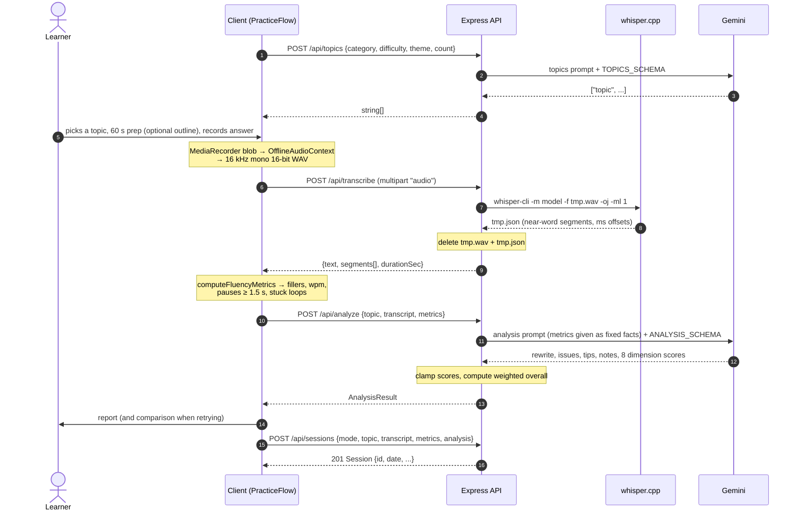

# Architecture

This document describes how Speak Up is put together: its components, how a practice attempt moves through the system, the HTTP API, the data model, and the security and failure model. The reasoning behind the major choices is in [DESIGN_DECISIONS.md](DESIGN_DECISIONS.md).

## System context

Speak Up is a single-user application that runs entirely on the learner's machine, apart from one external dependency: the Gemini API.



**Trust boundaries.** The browser is treated as untrusted input: every request body is validated on the server. Gemini is an untrusted *output* source, constrained by a response schema and post-processed (scores are clamped and the overall score is recomputed). Audio never crosses the machine boundary.

## Components

### Client (`client/`)

A React single-page app with no router: the four tabs are local state in `App.tsx`. The code is split into framework-free logic (`src/lib/`) and UI components grouped by flow (`src/components/`).

| Module | Responsibility |
| --- | --- |
| `App.tsx` | Tab shell. Holds the "retry a past session" state and lazy-loads History, which keeps Recharts out of the initial bundle. |
| `components/layout/*` | `AppHeader` (navigation: a 4-column bar on phones) and `SystemStatus`, a readiness indicator backed by `GET /api/health` that names any missing setup step in its tooltip. |
| `components/ui/*` | Small presentational primitives (Button, Card, Alert, Field/Select/TextInput, Badge, EmptyState, PageHeader, Spinner) that every screen is built from. |
| `index.css` | Design tokens: semantic colours (`canvas`, `surface`, `line`, `fg`, `muted`, `accent`, `success`/`warning`/`danger`…) defined once for light and dark, following the OS preference. |
| `components/modes/*` | Entry screens for each mode. Each one fetches its practice content (topics, an interview question, or a vocab word), then hands a topic to `PracticeFlow`. |
| `components/practice/PracticeFlow.tsx` | State machine for one attempt: `prep → practice → transcribing → analyzing → report`, or `error` (which can retry back to `practice`). It orchestrates the API calls and saves the result. |
| `components/practice/Recorder.tsx` | `MediaRecorder` capture. Releases the microphone on stop and on unmount, then hands back a WAV via `lib/wavEncoder`. |
| `components/practice/Timer.tsx`, `PrepTimer.tsx`, `ProgressRing.tsx`, `StageStepper.tsx` | The speaking timer (a pacing aid only), the prep countdown with outline notes, the shared ring visual, and the Prepare → Speak → Analyse → Review progress indicator. |
| `components/report/*` | `AnalysisReport` renders one attempt; `ScoreDisplay` provides the overall gauge, dimension bars and score pills; `SessionComparison` shows score deltas and transcripts against a previous attempt. |
| `components/history/*` | Headline stats, trend chart, `Insights` (focus areas), and the expandable session list. |
| `lib/wavEncoder.ts` | Decodes the browser recording (WebM/Opus or similar), downmixes and resamples to 16 kHz mono with `OfflineAudioContext`, and encodes 16-bit PCM WAV. |
| `lib/fluency.ts` | Deterministic metrics from the transcript and segment timestamps. |
| `lib/scores.ts`, `lib/insights.ts` | Score dimensions, score bands (strong / developing / needs work), attempt comparison, history stats, and weak-point aggregation. |
| `lib/api.ts` | Typed `fetch` wrapper. Converts server `{ error }` bodies and network failures into `ApiError` with a user-facing message. |

### Server (`server/`)

Express 5 with ES modules. `src/index.js` is the composition root: it reads config, builds the services and passes them into `createApp()`. Routes therefore never import infrastructure directly, which lets the tests build the real app around stub services.



| Module | Responsibility |
| --- | --- |
| `config.js` | Loads `server/.env`, applies defaults, validates numeric values, and returns a frozen config object. |
| `app.js` | JSON body limit (2 MB), cross-site request rejection, the `/api` router, the JSON 404 for unknown API paths, static serving of `client/dist` when it exists, and the central error handler. |
| `routes/content.js` | `POST /topics`, `/vocab`, `/interview-sample`. |
| `routes/speech.js` | `POST /transcribe` (multipart upload to a temp `.wav` file, always deleted before responding) and `POST /analyze`. |
| `routes/sessions.js` | `GET` and `POST /sessions`. The server assigns `id` and `date`. |
| `services/gemini.js` | `askJSON({ prompt, schema })`: one call with a response schema, one retry on unparseable JSON, and SDK errors mapped to client-safe `HttpError`s (429 → rate limit, others → 502). |
| `services/whisper.js` | Spawns `whisper-cli -oj -ml 1` with a timeout, parses its JSON into `{ text, segments, durationSec }`, computes duration from the WAV header, and checks the installation for `/api/health`. |
| `services/sessionStore.js` | JSON-file persistence: atomic writes, a serialised append queue, and fail-closed reads. |
| `prompts.js` / `schemas.js` | All prompt text and the Gemini response schemas. User text is embedded with `JSON.stringify`. |
| `scoring.js` | Score weights; clamps each dimension to 0–100 and computes the overall score. |
| `validation.js` / `errors.js` | Small validators that throw `HttpError(400, …)`; `HttpError` marks a message as safe to show the client. |

## Data flow: one practice attempt



Two details matter here:

- **Where the computation lives.** Metrics that can be measured are measured (step 9), and the model is told to use them as given. The model only supplies judgments: rewrites, explanations and per-dimension scores.
- **Save failures do not hide results.** If step 15 fails, the report stays on screen with a warning, because the analysis has already been paid for in quota and time.

## HTTP API

All endpoints are under `/api`, take and return JSON (except the multipart upload), and report errors as `{ "error": string }` with an appropriate status.

| Method & path | Request | Success | Notable errors |
| --- | --- | --- | --- |
| `GET /health` | – | `{ gemini: { configured }, whisper: { binary, model } }` | – |
| `POST /topics` | `{ category?, difficulty?, theme?, count?, interview? }` | `200 string[]` | `400` (unknown category or difficulty, `count` outside 1–10, theme over 100 chars) |
| `POST /vocab` | `{}` | `200 { word, definition, example, speakingAngle }` | – |
| `POST /interview-sample` | `{ question, framework: STAR\|PREP\|PPF\|MECE }` | `200 { sample }` | `400` |
| `POST /transcribe` | multipart, field `audio` (WAV, ≤ 25 MB) | `200 { text, segments[{text,start,end}], durationSec }` | `400` (no file or not a WAV), `413` (too large), `503` (whisper missing), `504` (timeout) |
| `POST /analyze` | `{ topic, transcript (non-blank), metrics }` | `200 AnalysisResult` | `400` |
| `GET /sessions` | – | `200 Session[]`, newest first | `500` (unreadable history file) |
| `POST /sessions` | `{ mode, topic, transcript, metrics, analysis }` | `201 Session` (server-assigned `id` and `date`) | `400` |

The AI routes can also return `429` (Gemini rate limit), `502` (a Gemini error or invalid output) and `503` (no API key). Any route returns `403` for a cross-site browser request (see [Security model](#security-model)). Unexpected failures return a generic `500`; the details go only to the server log.

## Data model

History is a single JSON array in `server/data/sessions.json` (the directory can be changed with `DATA_DIR`). The canonical type is `Session` in `client/src/types.ts`:

```ts
Session {
  id: string                       // server-assigned UUID
  date: string                     // server-assigned ISO timestamp
  mode: 'random' | 'interview' | 'vocab'
  topic: string
  transcript: string
  metrics: FluencyMetrics          // fillerCount, fillerBreakdown, wpm, pauseCount,
                                   // longestPauseSec, totalPauseSec, stuckLoops?
  analysis: AnalysisResult         // nativeRewrite, grammarIssues[], pronunciationTips[],
                                   // fluencyCommentary, topicRelevanceNote?, ideaDepthNote?,
                                   // stuckPoints?, scores, summary
}
```

**Schema evolution.** There is no migration step. Fields added over time (`topicRelevance`, `ideaDepth`, their notes, `stuckPoints`, `stuckLoops`, grammar `category`) are optional in the types, and every view treats a missing value as "not available" rather than 0. A legacy session therefore renders with fewer sections, and comparisons and insights skip the dimensions it lacks.

**Shared constants.** The client and server are separate packages with no shared module, so three lists are deliberately duplicated and cross-referenced in comments: grammar categories, topic-category ids, and interview-framework ids. Server-side validation means any drift shows up immediately as a `400`, not silent misbehaviour.

## Error handling

| Layer | Strategy |
| --- | --- |
| Server routes | No `try/catch` boilerplate: Express 5 forwards rejected promises to the central error handler. Expected failures throw `HttpError(status, safeMessage)`. |
| Error handler | `HttpError` returns its status and message. Multer errors return `413`/`400`; body-parser client errors (bad JSON) return `400`. Anything else returns a generic `500`, with the error logged including method and path. |
| External processes | whisper has a timeout and a capped stderr buffer; temp files are removed in `finally` blocks. |
| Client | `lib/api.ts` converts every failure into an `ApiError` with a readable message, including "server unreachable". Every screen that calls the API renders that message. |

## Security model

The threat model is local: protect the API key, the Gemini quota and the practice history from *other software and other machines*. A single local user is trusted.

- **Loopback-only bind.** The server listens on `127.0.0.1` by default, not all interfaces, so devices on the same network cannot reach it.
- **No CORS.** The API sends no `Access-Control-Allow-*` headers, so scripts on other websites cannot read its responses. The client stays same-origin through the Vite proxy in development and Express static serving in production.
- **Cross-site request rejection.** Without CORS, a malicious page could still fire "simple" cross-site requests (a form POST to `/api/vocab`, a multipart POST to `/api/transcribe`) that spend quota or CPU without ever reading the result. Every `/api` request with a `Sec-Fetch-Site` header other than `same-origin`/`none` is therefore rejected with `403` before reaching a route.
  - Requests without the header (curl, scripts, very old browsers) are allowed; non-browser clients aren't a CSRF vector.
- **Secrets.** The Gemini key lives only in `server/.env` (gitignored) and is never sent to the browser.
- **Input limits:**
  - JSON bodies up to 2 MB;
  - uploads up to 25 MB, one file, written under a server-generated UUID filename;
  - strict validation and length caps on every user-supplied field.
- **Prompt hygiene.** User text is embedded in prompts as JSON string literals, so quotes or newlines cannot break out of their slot. This is not a complete defence against prompt injection, but the only party who could exploit it is the user, against their own feedback.
- **Information disclosure.** Unexpected errors are reported to the client as a generic `500`, and `X-Powered-By` is disabled.

## Testing strategy

| Level | Where | What |
| --- | --- | --- |
| Unit | `server/test/{whisper,scoring,prompts,gemini}.test.js`, `client/src/lib/*.test.ts` | Pure logic: parsing, metrics, scoring, insights, encoding, prompt construction. |
| Persistence | `server/test/sessionStore.test.js` | Real file system in a temp dir: ordering, 25 concurrent appends, a corrupted file is never overwritten, no leftover temp files. |
| HTTP | `server/test/app.test.js` | The real Express app on an ephemeral port, with stub `askJSON` and `transcribeWav`: validation, status codes, error mapping, cross-site rejection, upload cleanup, server-side scoring. |
| Integration | `server/test/whisper.integration.test.js` | The real whisper.cpp binary on a generated WAV. Skipped when it is not installed. |
| Manual | – | Covers the UI and the live Gemini calls; see TODO.md for what is not automated. |
