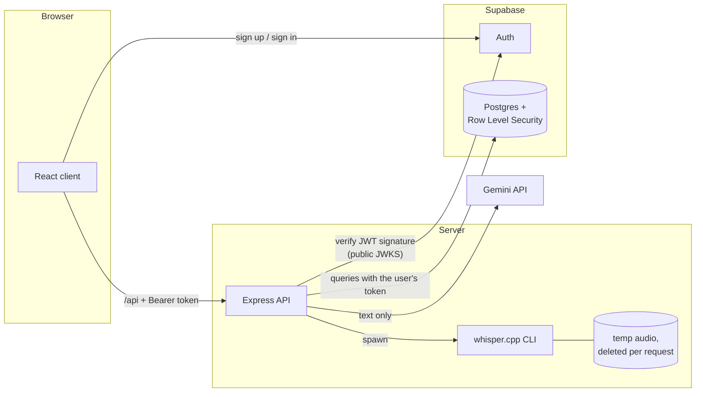

# Speak Up

A practice app for **impromptu English speaking**. You get a topic, take a minute to plan, speak while a timer runs, and then get structured feedback on what you said: a transcript, a native-speaker rewrite, grammar corrections, pronunciation tips, fluency statistics and scores across eight dimensions. History and trend views show which weak points keep recurring.

Each learner has their own account, and their practice history is private to that account. Audio is transcribed on the server with whisper.cpp and deleted straight away; only the transcript, metrics and feedback are stored.

## Features

- **Accounts.** Email and password sign-up and sign-in with [Supabase Auth](https://supabase.com/docs/guides/auth). Sessions persist across reloads and refresh automatically, and an expired session sends you back to sign-in with a message.
- **Three practice modes**
  - **Random Topic**: AI-generated topics by category (general, opinion, ELI5, professional, storytelling), difficulty and optional theme.
  - **Interview Prep**: behavioural questions, with four answer frameworks (STAR, PREP, PPF, MECE) and an on-demand sample answer for the chosen framework.
  - **Vocab**: a B1–C1 word with a definition, an example, and a speaking prompt that makes you use it.
- **Guided attempt**: a 60-second prep countdown with an optional three-line outline, then an adjustable speaking timer (1/3/5 min, ±30 s).
- **Transcription** with [whisper.cpp](https://github.com/ggml-org/whisper.cpp), including near-word-level timestamps. Uploads are temporary files that are deleted after every request.
- **Deterministic fluency metrics**, computed in code rather than by the model: filler words (by type), words per minute, pause count, longest and total pause, and "stuck loops" (phrases repeated while searching for the next idea).
- **AI analysis** with Gemini, using a strict response schema:
  - a native-speaker rewrite;
  - up to 5 categorised grammar issues;
  - up to 3 pronunciation tips;
  - feedback on topic relevance and idea depth;
  - a concrete alternative for each stuck loop;
  - eight 0–100 scores, plus a weighted overall score computed on the server.
- **Private history** in Supabase Postgres:
  - headline stats and an overall-score trend chart;
  - "focus areas" (weakest dimensions, recurring grammar categories);
  - a full report for every attempt;
  - retry a past topic with a side-by-side comparison;
  - delete a session.

  Every number is calculated only from your own sessions.
- **Interface**:
  - light and dark themes;
  - a responsive layout down to phone width;
  - a header indicator showing whether Gemini, whisper.cpp and Supabase are configured.

## Architecture at a glance



How a practice attempt flows:

1. The browser signs in with Supabase Auth and sends the access token with every API call.
2. The server verifies the token and takes the user id **only** from it.
3. The server reads and writes that user's sessions using the user's own token, so Postgres Row Level Security enforces ownership on every query.

[ARCHITECTURE.md](ARCHITECTURE.md) has the data flow, the API reference and the security model. [DESIGN_DECISIONS.md](DESIGN_DECISIONS.md) explains the trade-offs.

## Tech stack

| Layer | Technology |
| --- | --- |
| Client | React 19, TypeScript, Vite 8, Tailwind CSS 4, Recharts, Lucide icons, `@supabase/supabase-js` (auth only) |
| Server | Node.js (ESM), Express 5, Multer, `@google/genai`, `@supabase/supabase-js`, `jose` (JWT verification) |
| Auth & database | Supabase Auth; Supabase Postgres with Row Level Security; SQL migrations in `supabase/migrations/` |
| Speech-to-text | whisper.cpp CLI, `ggml-base.en` model |
| AI analysis | Gemini (`gemini-flash-lite-latest` by default) |
| Quality | Vitest (client), `node:test` (server), oxlint, `tsc` |

## Prerequisites

- **Node.js 22.12 or newer.**
- **A Supabase project.** The free tier is enough: [supabase.com/dashboard](https://supabase.com/dashboard).
- **A Gemini API key** from [aistudio.google.com/apikey](https://aistudio.google.com/apikey); it is free and needs no billing.
- **whisper.cpp**: the `whisper-cli` binary and an English model (see setup step 5).
- **A browser with `MediaRecorder` and microphone access.**

## Setup

1. **Install dependencies** for the root, server and client:

   ```bash
   npm run install:all
   ```

2. **Create the database table.** In the Supabase dashboard, open **SQL Editor** and run the contents of [`supabase/migrations/20261010120000_create_practice_sessions.sql`](supabase/migrations/20261010120000_create_practice_sessions.sql). It creates `practice_sessions` with its constraints, index, Row Level Security policies and privileges.

   If you use the [Supabase CLI](https://supabase.com/docs/guides/cli) instead, run `supabase link` and then:

   ```bash
   supabase db push
   ```

3. **Configure Auth** (Dashboard → Authentication → Sign In / Providers):
   - **Email** provider: enabled.
   - **Confirm email**: on for real use. New accounts must click the emailed link before signing in, and the app shows a "check your email" screen.
   - **Site URL / Redirect URLs** (Authentication → URL Configuration): add `http://localhost:5173`, plus your production URL if you have one.

4. **Configure the server and client.** Fill in the copied files with values from Dashboard → Project Settings → API, plus your Gemini key.

   ```bash
   cp server/.env.example server/.env
   ```

   ```bash
   cp client/.env.example client/.env.local
   ```

   - **Server:** `server/.env` needs `GEMINI_API_KEY`, `SUPABASE_URL` and `SUPABASE_PUBLISHABLE_KEY`.
   - **Client:** `client/.env.local` needs `VITE_SUPABASE_URL` and `VITE_SUPABASE_PUBLISHABLE_KEY`, set to the same project.

   Never put the **service-role** key in `client/` or in any `VITE_` variable. The running server doesn't use it either (see the variables table).

5. **Install whisper.cpp.** The server looks for the files below by default; override them with `WHISPER_BIN_PATH` and `WHISPER_MODEL_PATH`.

   ```
   whisper/bin/whisper-cli.exe        (whisper-cli on macOS/Linux)
   whisper/models/ggml-base.en.bin
   ```

   - **Binary on Windows:** download `whisper-bin-x64.zip` from the [whisper.cpp releases](https://github.com/ggml-org/whisper.cpp/releases). Extract it so that `whisper-cli.exe` and its DLLs sit directly in `whisper/bin/`.
   - **Binary on macOS/Linux:** build from source, then set `WHISPER_BIN_PATH` to `build/bin/whisper-cli`:
     ```bash
     git clone https://github.com/ggml-org/whisper.cpp
     cmake -S whisper.cpp -B whisper.cpp/build
     cmake --build whisper.cpp/build --config Release
     ```
   - **Model:** download [`ggml-base.en.bin`](https://huggingface.co/ggerganov/whisper.cpp/resolve/main/ggml-base.en.bin) (~148 MB) into `whisper/models/`.

6. **Check the setup.** Start the app (next section) and open <http://localhost:5173/api/health>, the only public endpoint. You should see:

   ```json
   {"gemini":{"configured":true},"whisper":{"binary":true,"model":true},"auth":{"configured":true}}
   ```

## Running

| Command (from repo root) | What it does |
| --- | --- |
| `npm run dev` | Starts the API (`127.0.0.1:4000`, auto-restart) and the Vite dev server (`localhost:5173`). Open **http://localhost:5173** and create an account. |
| `npm run build` | Type-checks the client and builds it into `client/dist/`; the `VITE_*` values are baked in at build time. |
| `npm start` | Runs the API. If `client/dist/` exists it also serves the built app, at **http://localhost:4000**. |

## Environment variables

**Server** (`server/.env`):

| Variable | Default | Purpose |
| --- | --- | --- |
| `GEMINI_API_KEY` | *(required)* | Gemini API key. Without it the AI routes return `503`. |
| `SUPABASE_URL` | *(required)* | Project URL, e.g. `https://abcd.supabase.co`. |
| `SUPABASE_PUBLISHABLE_KEY` | *(required)* | Publishable key, or the legacy `anon` key (`SUPABASE_ANON_KEY` is accepted as a fallback name). Public; database access runs under each user's token. |
| `SUPABASE_JWT_SECRET` | – | Only for projects still on the legacy shared JWT secret (HS256). Projects with asymmetric signing keys are verified via the public JWKS. |
| `SUPABASE_SERVICE_ROLE_KEY` | – | **Not used by the running API.** Only for `npm run import:legacy` and the opt-in integration tests. It bypasses RLS: keep it server-side. |
| `HOST` / `PORT` | `127.0.0.1` / `4000` | Bind address. If you change the port, start the client with `API_URL=http://127.0.0.1:<port>`. |
| `GEMINI_MODEL` | `gemini-flash-lite-latest` | Model alias used for every call. |
| `WHISPER_BIN_PATH` / `WHISPER_MODEL_PATH` | `<repo>/whisper/...` | whisper.cpp CLI and model. |
| `WHISPER_TIMEOUT_MS` | `300000` | Kills a transcription that takes longer than this. |
| `DATA_DIR` | `server/data` | Where temporary uploads are staged during transcription. |

**Client** (`client/.env.local`, public values only):

| Variable | Purpose |
| --- | --- |
| `VITE_SUPABASE_URL` | Same project URL as the server. |
| `VITE_SUPABASE_PUBLISHABLE_KEY` | Same publishable (or anon) key as the server. |

## Importing history from the single-user version

Earlier versions stored history in `server/data/sessions.json`, with no owner. The import never guesses an owner: you name the account explicitly, it dry-runs by default, and it is safe to re-run.

1. Create (or sign up for) the account that should own the old sessions, and copy its user id (Dashboard → Authentication → Users).
2. Add `SUPABASE_SERVICE_ROLE_KEY` to `server/.env`.
3. Preview the import. Nothing is written; this validates every record and prints the owner's email so you can confirm:

   ```bash
   npm run import:legacy --prefix server -- --user-id <uuid>
   ```

4. Import:

   ```bash
   npm run import:legacy --prefix server -- --user-id <uuid> --apply
   ```

Records keep their original id and date. Ids that already exist are skipped, never overwritten or re-assigned, and invalid records are skipped with a reason. Once you have verified the import, you can archive or delete `sessions.json` and remove the service-role key from `server/.env`.

## Testing and quality checks

| Command (from repo root) | What it runs |
| --- | --- |
| `npm test` | Server tests (`node:test`), then client tests (Vitest). |
| `npm run lint` | oxlint on both packages, with warnings treated as errors. |
| `npm run check` | Lint, tests, then a production build. |

What the tests cover:

- **Authentication.** The real JWT verifier is tested with locally generated signing keys:
  - valid, expired, wrong-key, wrong-issuer, wrong-audience, anon-role, unsigned and malformed tokens;
  - legacy HS256;
  - signing keys that can't be fetched.

  Every private route rejects missing and invalid tokens, and unauthenticated uploads never touch disk.
- **Ownership and isolation** at the API level:
  - the owner comes from the token, not the body;
  - user A cannot list or delete user B's sessions;
  - a foreign delete returns the same 404 as a missing one;
  - query parameters cannot redirect a read.
- **Database contract and failures.** The real Supabase client runs against a local stand-in for PostgREST, checking that:
  - queries carry the user's token and a `user_id` filter;
  - an unreachable database returns 503 and server errors return a generic 500;
  - a rejected JWT returns 401, and constraint violations return 400.
- **Legacy import** planning: explicit owner, validation, duplicates.
- The earlier coverage remains: AI routes, whisper (including a test running the real binary), scoring and prompts. On the client: metrics, WAV encoding, insights, the API client's token refresh and retry, and auth error messages.
- **Real-project isolation tests** (`server/test/supabase.integration.test.js`):
  - two throwaway users go through the real app and real Row Level Security;
  - cross-user reads, inserts and deletes are attempted directly against the database;
  - updates and client-chosen `created_at` must be refused;
  - concurrent writes from both users must stay separate.

  This suite is opt-in, because it creates and then deletes users in the configured project:

  ```bash
  RUN_SUPABASE_TESTS=1 npm test --prefix server
  ```

  It needs `SUPABASE_SERVICE_ROLE_KEY` in `server/.env` and the migration applied.

React components have no automated tests; see [TODO.md](TODO.md).

## Project structure

```
.
├── client/                      React + Vite front end
│   ├── .env.example             Public Supabase settings (copy to .env.local)
│   └── src/
│       ├── App.tsx              Auth gate → app shell (keyed by user); lazy-loads History
│       ├── auth/                AuthProvider (Supabase session), useAuth, auth error messages
│       ├── lib/                 api.ts (Bearer token, refresh-and-retry), supabase.ts, metrics, scores, insights…
│       ├── index.css            Design tokens (light/dark)
│       └── components/
│           ├── auth/            Sign-in / create-account screen
│           ├── layout/          Header, navigation, account menu, readiness indicator
│           ├── ui/              Shared primitives
│           ├── modes/ practice/ report/ history/
├── server/                      Express API
│   ├── src/
│   │   ├── index.js             Composition root
│   │   ├── app.js               Middleware order: cross-site check → /health → requireAuth → routes
│   │   ├── services/auth.js     JWT verification + requireAuth middleware
│   │   ├── services/sessionRepository.js  Per-user Supabase queries (user's token, RLS)
│   │   ├── services/            gemini, whisper
│   │   └── routes/ prompts.js schemas.js scoring.js validation.js errors.js config.js
│   ├── scripts/import-legacy-sessions.js  One-off, explicit-owner legacy import
│   └── test/                    Unit, HTTP, contract and opt-in real-project tests
├── supabase/migrations/         SQL migrations (table, constraints, index, RLS, grants)
└── whisper/                     whisper.cpp binary + model (gitignored)
```

## Important implementation details

- **Identity comes from the token, and only from it.** `requireAuth` verifies the access token's signature, issuer, audience and expiry, and puts `{ userId }` on the request. Routes ignore any `user_id` sent by the client.
- **Two layers of ownership enforcement.**
  - Every query is filtered by `user_id`.
  - Every query also runs with the user's own JWT, so Postgres RLS applies independently.

  The running server never holds a key that could bypass RLS.
- **Sessions are immutable.** There is no update grant or policy; users can create, read and delete their own sessions.
- **Temporary audio only.** Uploads get a random filename and are deleted before the response is sent. No audio is ever stored in the database.
- **No shared per-user state on the server.** Each request builds its own database client from its own token. In the browser, the whole app remounts when the signed-in user changes, so nothing carries over between accounts.
- **Older session data still renders.** Fields added over time are optional in the types.

## Troubleshooting

| Symptom | Likely cause |
| --- | --- |
| Sign-in screen says "Sign-in is not configured" | `client/.env.local` is missing `VITE_SUPABASE_*`. Restart `npm run dev` after creating it. |
| Every API call returns `401 token_invalid` | Server and client point at different projects; or the project uses the legacy HS256 secret (set `SUPABASE_JWT_SECRET`). |
| `503` "Sign-in is not configured on the server" | `SUPABASE_URL` / `SUPABASE_PUBLISHABLE_KEY` missing in `server/.env`. |
| History shows "temporarily unavailable" | Supabase unreachable, or the migration was not applied. Check the server log for the underlying error. |
| "Please confirm your email address first" | Email confirmation is on: click the link in the sign-up email. |
| `429` "Gemini rate limit reached" | Free-tier quota. Wait a minute. |
| `503` "Could not start whisper.cpp" | Wrong `WHISPER_BIN_PATH`, or the DLLs are not next to `whisper-cli.exe`. |

Known limitations and planned work are tracked in [TODO.md](TODO.md).
