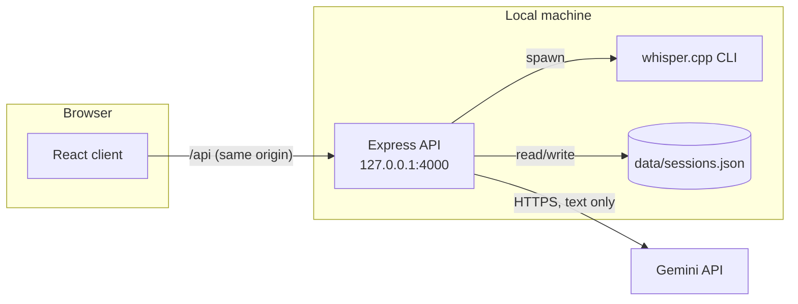

# Speak Up

A personal practice app for **impromptu English speaking**. You get a topic, take a minute to plan, speak while a timer runs, and then get structured feedback on what you said: a transcript, a native-speaker rewrite, grammar corrections, pronunciation tips, fluency statistics and scores across eight dimensions. History and trend views show which weak points keep recurring.

It is built for one person on one machine. There are no accounts and no billing. Your audio is transcribed locally and never leaves your computer; the only network traffic is text sent to the Gemini API.

## Features

- **Three practice modes**
  - **Random Topic**: AI-generated topics by category (general, opinion, ELI5, professional, storytelling), difficulty and optional theme.
  - **Interview Prep**: behavioural questions, with four answer frameworks (STAR, PREP, PPF, MECE) and an on-demand sample answer for the chosen framework.
  - **Vocab**: a B1–C1 word with a definition, an example, and a speaking prompt that makes you use it.
- **Guided attempt**: a 60-second prep countdown with an optional three-line outline, then an adjustable speaking timer (1/3/5 min, ±30 s).
- **Local transcription** with [whisper.cpp](https://github.com/ggml-org/whisper.cpp), including near-word-level timestamps.
- **Deterministic fluency metrics**, computed in code rather than by the model: filler words (by type), words per minute, pause count, longest and total pause, and "stuck loops" (phrases repeated while searching for the next idea).
- **AI analysis** with Gemini, using a strict response schema:
  - a native-speaker rewrite;
  - up to 5 categorised grammar issues;
  - up to 3 pronunciation tips;
  - feedback on topic relevance and idea depth;
  - a concrete alternative for each stuck loop;
  - eight 0–100 scores, plus a weighted overall score computed on the server.
- **History**:
  - an overall-score trend chart;
  - "weak points": the three lowest-averaging dimensions and recurring grammar categories across your last 10 sessions;
  - a full report for every past attempt;
  - **retry a past topic** with a side-by-side score and transcript comparison.

## Architecture at a glance



The browser records audio and converts it to 16 kHz mono WAV. The server transcribes it with whisper.cpp. The client turns the timestamps into fluency metrics, and the server sends the transcript and metrics to Gemini for analysis. [ARCHITECTURE.md](ARCHITECTURE.md) has the full data flow, the API reference and the security model. [DESIGN_DECISIONS.md](DESIGN_DECISIONS.md) explains why it is built this way.

## Tech stack

| Layer | Technology |
| --- | --- |
| Client | React 19, TypeScript, Vite 8, Tailwind CSS 4, Recharts |
| Server | Node.js (ESM), Express 5, Multer, `@google/genai` |
| Speech-to-text | whisper.cpp CLI, `ggml-base.en` model |
| AI analysis | Gemini (`gemini-flash-lite-latest` by default, free tier) |
| Storage | One local JSON file |
| Quality | Vitest (client), `node:test` (server), oxlint, `tsc` |

## Prerequisites

- **Node.js 22.12 or newer** (developed on Node 24).
- **A Gemini API key.** It is free and needs no billing: create one at [aistudio.google.com/apikey](https://aistudio.google.com/apikey).
- **whisper.cpp**: the `whisper-cli` binary and an English model (see setup step 3). These are large local downloads and are not in the repository.
- **A browser with `MediaRecorder` and microphone access** (any current Chrome, Edge or Firefox).

## Setup

1. **Install dependencies** for the root, server and client:

   ```bash
   npm run install:all
   ```

2. **Configure the server.** Copy the example file, then set `GEMINI_API_KEY` in `server/.env`:

   ```bash
   cp server/.env.example server/.env
   ```

3. **Install whisper.cpp.** The server looks for the files below by default; override them with `WHISPER_BIN_PATH` and `WHISPER_MODEL_PATH`.

   ```
   whisper/bin/whisper-cli.exe        (whisper-cli on macOS/Linux)
   whisper/models/ggml-base.en.bin
   ```

   - **Binary on Windows:** download `whisper-bin-x64.zip` from the [whisper.cpp releases](https://github.com/ggml-org/whisper.cpp/releases). Extract it so that `whisper-cli.exe` and the DLLs next to it sit directly in `whisper/bin/`.
   - **Binary on macOS/Linux:** build from source, then set `WHISPER_BIN_PATH` to the resulting `build/bin/whisper-cli`:
     ```bash
     git clone https://github.com/ggml-org/whisper.cpp
     cmake -S whisper.cpp -B whisper.cpp/build
     cmake --build whisper.cpp/build --config Release
     ```
   - **Model:** download [`ggml-base.en.bin`](https://huggingface.co/ggerganov/whisper.cpp/resolve/main/ggml-base.en.bin) (~148 MB) into `whisper/models/`. Larger models such as `ggml-small.en.bin` are more accurate but slower.

4. **Check the setup.** Start the app (next section) and open <http://localhost:5173/api/health>. You should see:

   ```json
   {"gemini":{"configured":true},"whisper":{"binary":true,"model":true}}
   ```

   The server also prints a warning at startup for anything that is missing.

## Running

| Command (from repo root) | What it does |
| --- | --- |
| `npm run dev` | Starts the API (`127.0.0.1:4000`, auto-restart) and the Vite dev server (`localhost:5173`). Open **http://localhost:5173**. |
| `npm run build` | Type-checks the client and builds it into `client/dist/`. |
| `npm start` | Runs the API alone. If `client/dist/` exists, it also serves the built app, so after `npm run build` the whole app is at **http://localhost:4000**. |

In development, Vite proxies `/api` to the server, so the browser only ever talks to a single origin (see [Security](ARCHITECTURE.md#security-model)).

## Environment variables

All variables are read by the server from `server/.env`. Only the API key is required.

| Variable | Default | Purpose |
| --- | --- | --- |
| `GEMINI_API_KEY` | *(none, required)* | Gemini API key. Without it the server still starts, but AI routes return `503`. |
| `HOST` | `127.0.0.1` | Interface to bind. Loopback-only by default; see the security note in `.env.example`. |
| `PORT` | `4000` | API port. If you change it, start the client with `API_URL=http://127.0.0.1:<port>` so the dev proxy follows. |
| `GEMINI_MODEL` | `gemini-flash-lite-latest` | Model alias used for every call. |
| `WHISPER_BIN_PATH` | `<repo>/whisper/bin/whisper-cli(.exe)` | whisper.cpp CLI. |
| `WHISPER_MODEL_PATH` | `<repo>/whisper/models/ggml-base.en.bin` | whisper model. |
| `WHISPER_TIMEOUT_MS` | `300000` | Kills a transcription that takes longer than this. |
| `DATA_DIR` | `server/data` | Location of `sessions.json` and temporary uploads. |

## Testing and quality checks

| Command (from repo root) | What it runs |
| --- | --- |
| `npm test` | Server tests (`node:test`), then client tests (Vitest). |
| `npm run lint` | oxlint on both packages, with warnings treated as errors. |
| `npm run check` | Lint, tests, then a production build: the full pre-submit check. |

What the tests cover:

- **Server**:
  - request validation and error mapping for every route, through the real Express app with Gemini and whisper replaced by in-test stubs;
  - session-store durability: concurrent writes, and corruption that must not be overwritten;
  - WAV header parsing, whisper output parsing, overall-score weighting, and prompt construction including escaping;
  - an **integration test that runs the real whisper.cpp binary**. It is skipped, not failed, when the binary or model is not installed.
- **Client**:
  - fluency metrics (fillers, pace, pauses, stuck-loop detection);
  - the WAV encoder;
  - score comparison, weak-point insights, and API-client error handling.

React components have no automated tests. They were checked manually; see [TODO.md](TODO.md).

## Project structure

```
.
├── client/                      React + Vite front end
│   └── src/
│       ├── App.tsx              Tab shell; lazy-loads History
│       ├── types.ts             Shared domain types (incl. legacy-session fields)
│       ├── lib/                 Framework-free logic, each with colocated *.test.ts
│       │   ├── api.ts           Typed API client + ApiError
│       │   ├── fluency.ts       Filler / pace / pause / stuck-loop metrics
│       │   ├── wavEncoder.ts    Recording → 16 kHz mono 16-bit WAV
│       │   ├── scores.ts        Score dimensions, colors, attempt comparison
│       │   ├── insights.ts      Weak-point aggregation across sessions
│       │   └── practiceOptions.ts  Categories, difficulties, interview frameworks
│       └── components/
│           ├── modes/           Random Topic, Interview Prep, Vocab entry screens
│           ├── practice/        PracticeFlow state machine, timers, recorder
│           ├── report/          AnalysisReport, SessionComparison
│           └── history/         SessionHistory, Insights
├── server/                      Express API
│   ├── src/
│   │   ├── index.js             Entry point: wires config → services → app, starts listening
│   │   ├── app.js               createApp(deps): middleware, routers, error handler
│   │   ├── config.js            Environment parsing and defaults
│   │   ├── routes/              content (topics/vocab/sample), speech (transcribe/analyze), sessions
│   │   ├── services/            gemini, whisper, sessionStore
│   │   ├── prompts.js           Prompt builders
│   │   ├── schemas.js           Gemini response schemas
│   │   ├── scoring.js           Weighted overall score
│   │   ├── validation.js        Request validators
│   │   └── errors.js            HttpError
│   ├── test/                    node:test suites
│   └── data/                    Runtime data (gitignored)
└── whisper/                     whisper.cpp binary + model (gitignored, see Setup)
```

## Important implementation details

- **Metrics are measured, not guessed.** Filler counts, pace and pauses are computed in code from whisper's timestamps and passed to the model as fixed facts. The model scores each dimension, and the server computes the weighted overall score, because LLM arithmetic is unreliable.
- **Pronunciation feedback is text-based.** whisper produces text, not phonetic data, so the tips flag words that learners commonly mispronounce; they do not assess your actual audio.
- **History is append-only JSON.** Writes are atomic (temp file + rename) and serialised. If the file is unreadable, the server reports an error instead of treating history as empty and overwriting it.
- **Sessions from older versions still load.** Early sessions lack some fields (topic relevance, idea depth, stuck points, grammar categories). These are typed as optional and their sections are hidden.
- **English only, on purpose.** The whisper model and the prompts are English-specific.

## Troubleshooting

| Symptom | Likely cause |
| --- | --- |
| "Could not reach the server" | The API isn't running. Use `npm run dev` from the repo root, not just the client. |
| `503` "GEMINI_API_KEY is not configured" | `server/.env` is missing or has no key. |
| `429` "Gemini rate limit reached" | Free-tier quota. Wait a minute, or set a different `GEMINI_MODEL`. |
| `503` "Could not start whisper.cpp" | Wrong `WHISPER_BIN_PATH`, or the DLLs are not next to `whisper-cli.exe`. |
| Transcript is "You" or similar for silent audio | A known whisper behaviour on silence; check your microphone input. |
| "Could not load your history" | `server/data/sessions.json` is unreadable or not valid JSON. The server refuses to overwrite it, so fix or move the file. |

Known limitations and planned work are tracked in [TODO.md](TODO.md).
